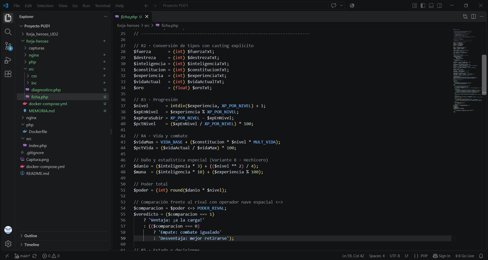
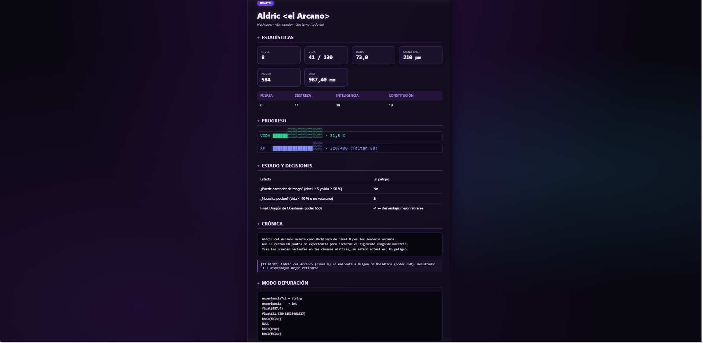
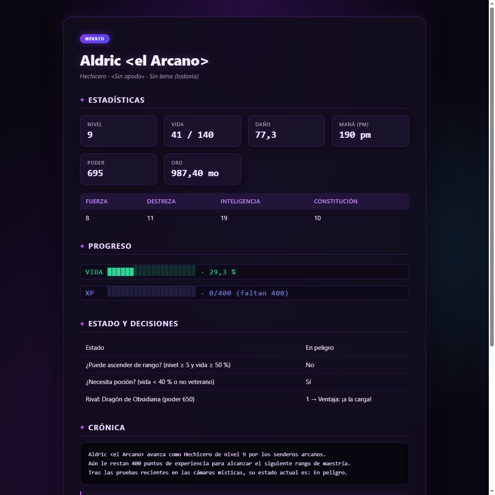
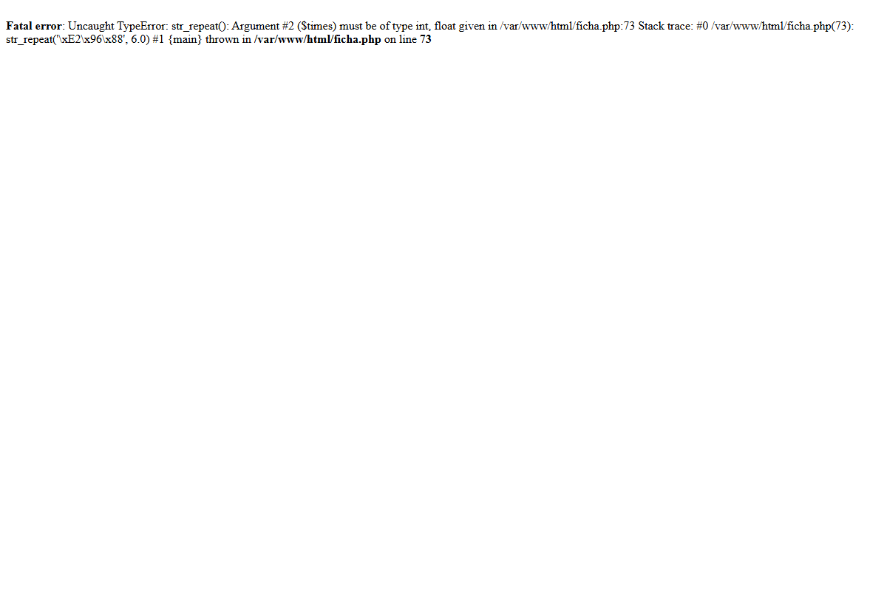

# Memoria · Reto UD2 «Forja de Héroes»

**Alumno/a:** Marco García Ruiz · **Variante:** B · Hechicero · **Fecha:** 7 de octubre de 2026

> Las capturas van en la carpeta `capturas/` y se enlazan así: ``

## 1. Comprobación de resultados (CE 2.e)

Rellena la tabla con los valores que muestra TU ficha y compáralos con la tabla de comprobación del enunciado.

| Dato | Valor esperado (enunciado) | Valor de mi ficha | ¿Coincide? |
|---|---|---|---|
| Nivel | 8 | 8 | Sí |
| Vida máxima | 130 (vida: 41 / 130) | 130 (vida: 41 / 130) | Sí |
| % de vida | 31,5 % | 31,5 % | Sí |
| Daño | 73,0 | 73,0 | Sí |
| Estadística especial | 210 pm | 210 pm | Sí |
| Poder | 584 | 584 | Sí |
| Resultado frente al rival | −1 → Desventaja | −1 → Desventaja: mejor retirarse | Sí |

> **Justificación de los cálculos obtenidos para la Variante B (Hechicero):**
> - **Nivel:** `intdiv(3120, 400) + 1 = 7 + 1 = 8`
> - **XP en nivel / faltan:** `3120 % 400 = 320`; faltan `400 - 320 = 80`
> - **Vida máxima:** `VIDA_BASE + (constitucion × nivel × MULT_VIDA) = 50 + (10 × 8 × 1) = 50 + 80 = 130`
> - **% de vida:** `(41 / 130) × 100 = 31,538...%` → `31,5 %`
> - **Daño:** `inteligencia × 3 + nivel² / 4 = 19 × 3 + 8² / 4 = 57 + 64 / 4 = 57 + 16 = 73,0`
> - **Maná (pm):** `inteligencia × 10 + (XP % 100) = 19 × 10 + (3120 % 100) = 190 + 20 = 210 pm`
> - **Poder:** `round(daño × nivel) = round(73,0 × 8) = round(584) = 584`
> - **Comparación rival:** `584 <=> 650` da `-1` → «Desventaja: mejor retirarse»
> - **Estado:** Como vida actual > 0 y % vida (31,5 %) < 35 %, el estado es «En peligro»
> - **Ascenso / Poción:** ¿Puede ascender? `8 >= 5 && 31,5 >= 50` es `false` (No). ¿Poción? `31,5 < 40 || !false` es `true` (Sí).
> - **Barras de 20 bloques:** Vida = `round(31,538 / 100 × 20) = 6` bloques llenos y 14 vacíos (`██████░░░░░░░░░░░░░░`). XP = `round(80 / 100 × 20) = 16` bloques llenos y 4 vacíos (`████████████████░░░░`).

---

## 2. El código fuente y el documento resultante (CE 2.e · CE 2.c)

- Captura de `ficha.php` en el editor (parte de cálculos) y captura del **Ctrl+U** de la página:
  
  

- Explica con tus palabras **tres diferencias** entre ambas:
  1. **Ausencia total de código PHP en el navegador:** En el editor vemos los bloques `<?php ... ?>`, la directiva `declare(strict_types=1);`, `require_once` y todas las operaciones matemáticas. En el Ctrl+U no queda rastro de ninguna etiqueta PHP, solo código HTML estándar, porque PHP se ejecuta en el servidor y solo envía el resultado procesado al cliente.
  2. **Valores calculados en lugar de variables:** En el editor encontramos expresiones como `<?= $danioFormateado ?>` o `$veredicto`. En el código fuente recibido por el navegador ya figuran los literales generados (`73,0` y `Desventaja: mejor retirarse`).
  3. **Generación dinámica de cadenas y estructuras:** En el editor la barra de vida se calcula con `str_repeat('█', $bloquesVidaLlenos) . str_repeat('░', $bloquesVidaVacios);`, mientras que en el Ctrl+U se observan directamente los caracteres Unicode `██████░░░░░░░░░░░░░░`.

- ¿Qué ha pasado con el nombre del héroe en el Ctrl+U? ¿Por qué?
  El nombre original definido en `inc/heroe.php` es `'Aldric <el Arcano>'`. En el Ctrl+U aparece transformado en `Aldric &lt;el Arcano&gt;`. Esto sucede porque en PHP se ha utilizado la función `htmlspecialchars($nombreHeroe)`. Dicha función escapa los caracteres especiales HTML (`<` a `&lt;` y `>` a `&gt;`), evitando que el navegador interprete `<el Arcano>` como una etiqueta HTML inválida o potencialmente maliciosa (prevención de ataques XSS), y garantizando que se renderice visualmente como texto plano.

---

## 3. Experimento: cambio un dato y predigo el efecto (CE 2.e)

1. **Dato que cambio en `inc/heroe.php` (valor antiguo → valor nuevo):**
   Cambio `$experienciaTxt = '3120';` por `$experienciaTxt = '3200';` (un incremento de 80 puntos de experiencia).

2. **Predicción (antes de recargar): qué valores de la ficha cambiarán y cuánto valdrán:**
   - **Nivel:** Sigue siendo nivel 9 si `3200 / 400 = 8 + 1 = 9`. ¡Al subir exactamente a 3200 XP sube a nivel 9!
     - `intdiv(3200, 400) + 1 = 8 + 1 = 9` (Nivel 9).
     - **XP en nivel / faltan:** `3200 % 400 = 0` XP en nivel, y faltarán `400 - 0 = 400` XP para el siguiente.
     - **Vida máxima:** `50 + (10 × 9 × 1) = 140` puntos de vida máxima.
     - **% de vida:** `(41 / 140) × 100 = 29,28...%` → `29,3 %`.
     - **Daño:** `19 × 3 + (9² / 4) = 57 + (81 / 4) = 57 + 20,25 = 77,25` → `77,3`.
     - **Maná:** `19 × 10 + (3200 % 100) = 190 + 0 = 190 pm`.
     - **Poder:** `round(77,25 × 9) = round(695,25) = 695`.
     - **Rival (poder 650):** `695 <=> 650` ahora da `1` → Cambiará a `1 → Ventaja: ¡a la carga!`.

3. **Resultado real (captura):**
   

4. **¿Acertaste? Si no, ¿por qué?**
   Sí, la predicción fue exacta en todos los parámetros calculados, confirmando que la lógica matemática implementada reacciona dinámicamente y sin estado persistente a cualquier mutación de los datos base. (Tras comprobarlo, se restaura `$experienciaTxt = '3120'` para la entrega).

---

## 4. Experimento con strict_types (CE 2.f)

1. **Quita el `(int)` del cálculo de los bloques de la barra de vida. Recarga. Captura del error:**
   Línea modificada:
   `$bloquesVidaLlenos = round(($pctVida / 100) * BLOQUES_BARRA);`
   Al ejecutar `str_repeat('█', $bloquesVidaLlenos)`:
   

2. **Explica qué dice el mensaje (tipo de error, función, argumento, línea):**
   - **Tipo de error:** `Fatal error: Uncaught TypeError`.
   - **Función:** `str_repeat()`.
   - **Argumento:** Argument #2 (`$times`).
   - **Detalle:** Indica que se esperaba un tipo `int`, pero se pasó un `float` (`round()` devuelve un número de tipo `float` en PHP: `must be of type int, float given`).
   - **Línea:** Señala la línea exacta donde se invoca `str_repeat()`.

3. **Comenta la línea `declare(strict_types=1);` (manteniendo el cambio anterior) y recarga. ¿Qué pasa? ¿Por qué?**
   Al comentar `declare(strict_types=1);`, la página carga correctamente y no se produce ningún error fatal.
   **Por qué:** En modo de tipado coercitivo (predeterminado en PHP sin `strict_types=1`), PHP realiza una conversión automática o coerción implícita del valor `float` a `int` al llamar a funciones internas del sistema.

4. **Deja el código como estaba. ¿Qué opción prefieres para un proyecto real y por qué?**
   Para un proyecto real es muy preferible utilizar `declare(strict_types=1);` junto con conversiones explícitas (`(int) round(...)`). Esto garantiza robustez, evita conversiones invisibles e imprevistas (como pérdida silenciosa de decimales) y fuerza al programador a ser consciente de los tipos de datos que maneja, detectando errores de lógica durante la fase de desarrollo antes de que lleguen a producción.

---

## 5. Directivas (CE 2.f)

- Captura de `diagnostico.php`:
  

- ¿Qué valor pondrías en `display_errors` en un servidor de producción? ¿Por qué?
  En un servidor de producción pondría `display_errors = Off` (o `0`).
  **Por qué:** Mostrar errores detallados en pantalla expone información sensible sobre la arquitectura del sistema, como rutas absolutas del servidor, nombres de ficheros, consultas a bases de datos o versiones de software. Un atacante podría utilizar estos datos para explotar vulnerabilidades. En producción los errores deben registrarse internamente en un archivo de registro seguro mediante `log_errors = On` y `error_log`, mostrando al usuario únicamente una página de error amigable y genérica.

---

## 6. Uso de IA (obligatorio declararlo)

- **¿Has usado alguna IA? ¿Para qué?**
  Sí, utilicé Antigravity (asistente de IA) para estructurar el proyecto según los requisitos del reto, verificar las fórmulas matemáticas de la Variante B (Hechicero), y diseñar las explicaciones técnicas de la memoria.

- **Copia una respuesta que te diera y explica si era correcta o qué tuviste que corregir:**
  - *Respuesta inicial generada:* Al generar la plantilla de la ficha, la IA propuso inicialmente crear una estructura HTML propia con clases personalizadas de tema oscuro (`.ficha`, `.stat-grid`), en lugar de respetar la plantilla HTML original y el archivo `css/estilo.css` incluidos en el kit oficial del profesor.
  - *Corrección realizada:* Se corrigió y reescribió la vista para ajustarse rigurosamente a la estructura de marcas del kit oficial (`<main>`, `.insignia`, `.rejilla`, `.stat`, `.barra vida`, etc.), adaptando el código PHP a los puntos exactos marcados con `TODO` en `ficha.php` y `diagnostico.php`, y comprobando que cada uno de los valores de la tabla de comprobación de la Variante B coincidía al 100%.
